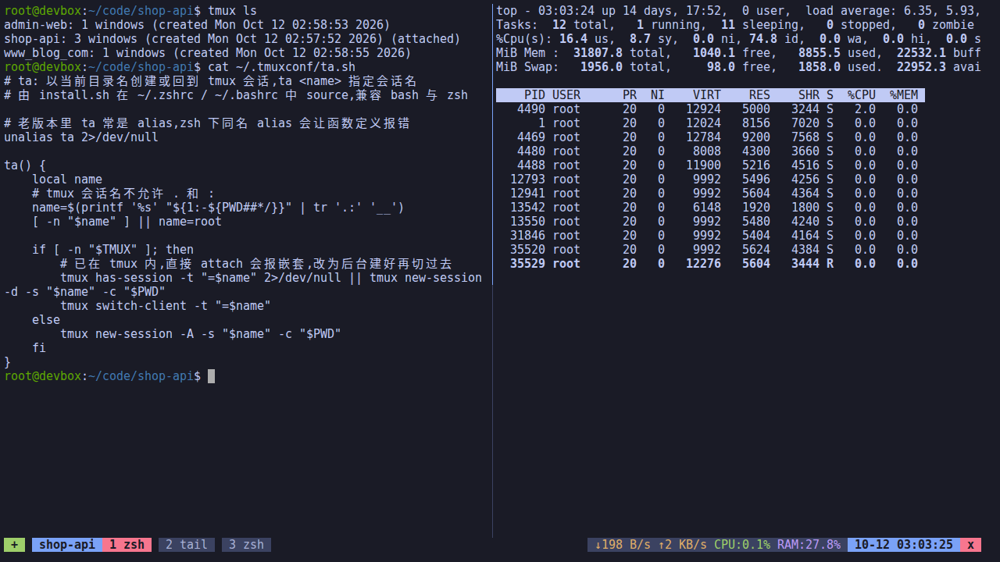
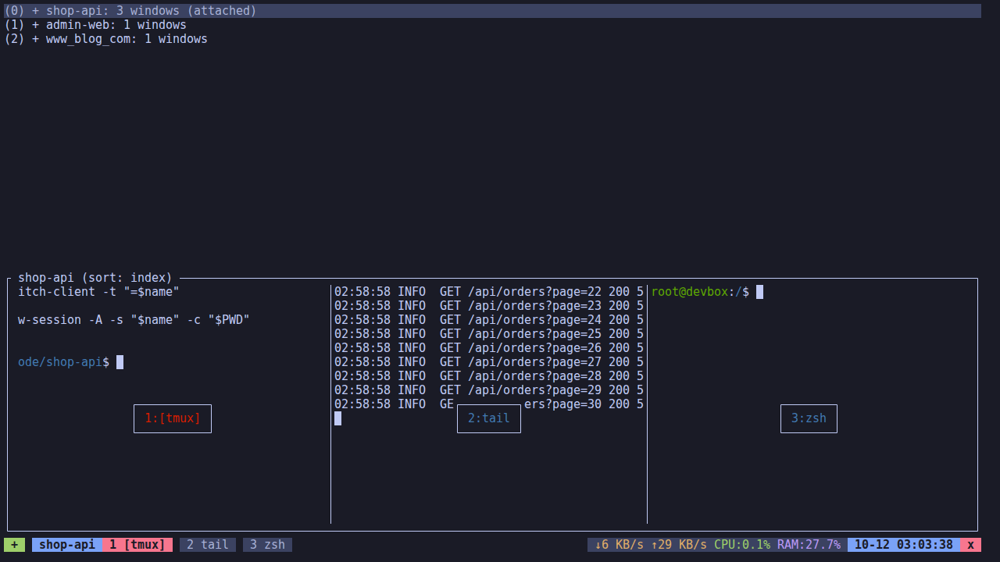

# tmuxconf

鼠标优先、为 CLI 编码 Agent 优化的 tmux 配置。

适合这样用的人：用 VS Code Remote-SSH 连 Linux 开发机，在终端里同时开着 Claude Code、Codex、pi 这些 Agent，外加 dev server、日志等后台服务；**会用 tmux，但不想记快捷键**。

- **全程鼠标**：点 `+` 新建窗口，中键关窗口，中键分屏，双击全屏，点 `x` 关窗格，拖选即复制
- **状态栏看机器**：实时显示上下行网速、CPU、内存
- **一个项目一个会话**：在项目目录下敲 `ta`，没有就新建，有就接回去
- **环境不丢**：关掉 VS Code、断网、换电脑，Agent 照样跑；开发机重启后自动恢复窗口布局并重新拉起 Agent
- **Agent 友好**：Shift+Enter 能正常换行，ESC 没有延迟，支持真彩色

https://github.com/user-attachments/assets/283ae488-130a-4800-b0ff-87d0a851f5dc



## 安装

把这句话发给 Claude Code / Codex 等 AI 助手：

```
帮我安装应用这个tmux配置 https://github.com/ninvfeng/tmuxconf
```

或者自己动手，需要 tmux ≥ 3.2 和 git：

```bash
curl -fsSL https://raw.githubusercontent.com/ninvfeng/tmuxconf/main/install.sh | bash
```

或者：

```bash
git clone https://github.com/ninvfeng/tmuxconf ~/.tmuxconf && ~/.tmuxconf/install.sh
```

> 💡 tmux 暂不支持 Windows。Windows 用户可以考虑用 WSL2 或者虚拟机装一个 Linux 作为开发环境，再用 VS Code 远程连进去使用。

安装脚本会：

1. 把原有的 `~/.tmux.conf` 备份为 `~/.tmux.conf.bak.<时间戳>`，再软链到本仓库的 `tmux.conf`
2. 安装 [TPM](https://github.com/tmux-plugins/tpm) 和插件
3. 在 `~/.zshrc` / `~/.bashrc` 里加一行，启用 `ta` 命令

升级：`cd ~/.tmuxconf && git pull`，然后在 tmux 里按 `prefix + r` 重载配置。

卸载：`~/.tmuxconf/uninstall.sh`，会恢复最近一次的备份。

## 鼠标操作

| 操作 | 效果 |
|---|---|
| 左键点状态栏左侧 `+` | 新建窗口（工作目录跟当前窗格一致） |
| 左键点会话名 | 打开会话 / 窗口列表，点一下切过去 |
| 左键点窗口标签 | 切换窗口 |
| 中键点窗口标签 | 关闭该窗口 |
| 中键点窗格 | 左右分屏 |
| 双击窗格 | 最大化 / 还原 |
| 左键点状态栏右侧 `x` | 关闭当前窗格 |
| 拖动窗格分隔线 | 调整大小 |
| 滚轮 | 翻看历史（保留 5 万行） |
| 拖选 / 双击 / 三击 | 选中即复制 / 选中单词 / 选中整行 |

复制使用 OSC 52，内容直接进**你本地电脑**的剪贴板，远端不用装 xclip。终端需要支持 OSC 52（iTerm2、Windows Terminal、Alacritty、kitty、WezTerm 等）。

## `ta`：一个项目一个会话

```bash
cd ~/code/shop-api
ta            # 进入 shop-api 会话，没有就新建
ta demo       # 指定会话名
```



- 会话名取当前目录名，`.` 和 `:` 会换成 `_`（`www.foo.com` 变成 `www_foo_com`）
- 已经在 tmux 里也能用，会直接切到目标会话
- 配合 VS Code：打开哪个项目，就在终端里 `ta` 进哪个项目的会话

## 快捷键（可选）

用不着也没关系，偶尔想用键盘时：

| 按键 | 效果 |
|---|---|
| `prefix + \|` / `prefix + -` | 左右 / 上下分屏 |
| `Alt + 方向键` 或 `Alt + h/j/k/l` | 切换窗格 |
| `Shift + 方向键` | 调整窗格大小 |
| `prefix + r` | 重载配置 |
| `prefix + Ctrl-s` / `prefix + Ctrl-r` | 手动保存 / 恢复环境 |

`prefix` 是默认的 `Ctrl-b`。

## 环境持久化

用 [tmux-resurrect](https://github.com/tmux-plugins/tmux-resurrect) + [tmux-continuum](https://github.com/tmux-plugins/tmux-continuum)：

- 每 15 分钟自动保存一次会话、窗口、窗格布局和工作目录
- tmux 服务启动时自动恢复（开发机重启后执行 `tmux` 或 `ta` 即可）
- 恢复时会重新拉起 `claude`、`codex`、`pi`、`vim`、`ssh`、`tail` 等程序

## 自定义

个人改动写到 `~/.tmux.conf.local`，它在主配置之后、TPM 之前加载，升级不会覆盖：

```tmux
# 换个前缀键
set -g prefix C-a
# 多加一个插件
set -g @plugin 'tmux-plugins/tmux-sessionist'
# 恢复时多拉起几个程序
set -g @resurrect-processes 'ssh vim nvim pi claude codex "~node" htop'
```

## 插件

- [tmux-plugins/tpm](https://github.com/tmux-plugins/tpm)
- [tmux-plugins/tmux-cpu](https://github.com/tmux-plugins/tmux-cpu)
- [tmux-plugins/tmux-net-speed](https://github.com/tmux-plugins/tmux-net-speed)
- [tmux-plugins/tmux-resurrect](https://github.com/tmux-plugins/tmux-resurrect)
- [tmux-plugins/tmux-continuum](https://github.com/tmux-plugins/tmux-continuum)

## License

MIT
